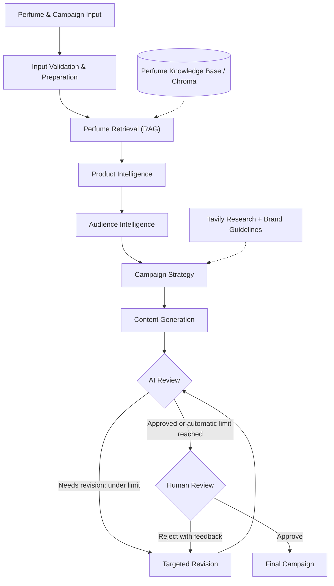

# 🌸 ScentFlow-AI

**A Multi-Agent System for Intelligent Perfume Campaign Generation**

*Agentic AI Engineering Capstone Project · Saudi Digital Academy*

ScentFlow-AI turns perfume details and campaign goals into **brand-aligned Arabic marketing content** for Instagram and Email. Instead of relying on a single large prompt, it coordinates specialized AI agents through a **LangGraph workflow** with retrieval, market research, structured validation, targeted revision, and human approval.

## ✨ Highlights

- **Specialized agents** for product analysis, audience analysis, campaign strategy, content generation, review, and revision.
- **RAG-powered perfume context** using Sentence Transformers, Chroma, and fragrance-note reranking.
- **Market-aware strategy** with optional Tavily research and predefined brand guidelines.
- **Arabic, channel-specific content**: a slogan plus Instagram and/or Email assets.
- **Hybrid quality checks** combining semantic LLM review with deterministic Python rules.
- **Targeted revisions** that aim to preserve unrelated, already-approved content.
- **Human-in-the-Loop approval** with LangGraph interrupts, resume, and checkpointing.
- **Observability** using LangSmith traces for workflow behavior, latency, tokens, and cost.

## 🧠 Why a Multi-Agent System?

A single content-generation prompt must handle product understanding, audience selection, market context, copywriting, brand constraints, and quality assurance at once. ScentFlow-AI separates these concerns into explicit stages with **typed outputs, controlled routing, and a human final decision**.

The objective is not just to generate content—it is to make the **campaign-generation process reviewable and correctable**.

## 🏗️ Architecture



The LangGraph workflow uses a shared `CampaignState` and a `MemorySaver` checkpointer. The **automatic** revision limit defaults to three; human-requested revisions follow a separate approval path.

The Streamlit frontend handles input preparation, sanitization, translation, and the human-review flow before resuming the workflow.

### Agent responsibilities

| Component | Role |
| --- | --- |
| Product Intelligence | Analyzes fragrance family, season, and wearing occasion using product details and retrieved context. |
| Audience Intelligence | Infers a target audience from the product and campaign context. |
| Campaign Strategy | Defines campaign theme, message, tone, and CTA direction using optional market research. |
| Content Generation | Produces an Arabic slogan and assets for the selected channels. |
| AI Review | Evaluates semantic and brand alignment alongside deterministic validation results. |
| Revision | Applies targeted corrections and preserves unaffected content where possible. |
| Human Review | Approves the campaign or requests changes before completion. |

## 🔎 Retrieval & Quality Controls

**Perfume RAG.** Perfume records are embedded using `sentence-transformers/all-mpnet-base-v2` and stored in Chroma. The system retrieves **10** candidates, reranks them by fragrance-note matches, and passes the **top 5** to downstream agents. Retrieved profiles are supporting context, not verified facts about a newly submitted perfume. The included test dataset combines collected and AI-generated records (see [data/README.md](data/README.md)).

**Hybrid review.** The LLM checks meaning, brand alignment, language, and unsupported claims. Python validators handle measurable Instagram rules such as caption length, hashtags, and emoji counts.

**Minimum-change revision.** Feedback targets the relevant content instead of regenerating everything. The workflow returns revised content to AI Review before human approval.

## 📊 Evaluation

The capstone report documented the following outcomes from its evaluation scenarios:

| Evaluation measure | Reported outcome |
| --- | ---: |
| Functional test cases | **8 / 8 passed** |
| Defined success criteria | **14 / 14 met** |
| Maximum automatic revision cycles | **3** |

The tested scenarios included end-to-end execution, invalid input handling, human rejection and targeted revision, automatic revision-loop control, deterministic rule correction, AI review consistency, and final output quality.

**Representative LangSmith traces** (observed during capstone evaluation):

| Metric | Direct approval | Reject + revision |
| --- | ---: | ---: |
| Workflow processing time | ~47.28 s | ~53.28 s |
| LLM tokens | 11.55K | 16.45K |
| Recorded cost | ~$0.0020 | ~$0.0028 |

*These are results from the documented capstone runs, not guarantees or independently rerun benchmarks for this public repository.*

## 🛠️ Tech Stack

| Layer | Technologies |
| --- | --- |
| Language | Python 3.11 |
| Workflow orchestration | LangGraph, LangChain |
| LLM integration | OpenAI-compatible ChatOpenAI |
| Structured contracts | Pydantic |
| Retrieval & embeddings | Chroma, Sentence Transformers |
| Market research | Tavily |
| Observability | LangSmith |
| Data processing | Pandas |
| Interface | Streamlit |

## 📂 Repository Structure

```text
ScentFlow-AI/
├── agents/           # Specialized agents
├── data/             # Perfume dataset and brand guidelines
├── frontend/         # Streamlit application
│   ├── app.py        # Entry point and step routing
│   ├── session.py    # Session state
│   ├── assets/       # Stylesheet
│   ├── components/   # Reusable UI pieces
│   ├── services/     # Input handling, translation, and workflow calls
│   └── views/        # Input, review, and final screens
├── prompts/          # Agent instructions and prompts
├── rag/              # Retrieval and reranking
├── schemas/          # Pydantic input/output contracts
├── validators/       # Deterministic validation
├── workflow/         # LangGraph state, nodes, and graph
├── config.py         # Environment-based LLM configuration
├── requirements.txt  # Python dependencies
└── README.md
```

## ⚙️ Setup

**Prerequisite:** Python 3.11 (the version used during development).

```bash
python -m venv venv
```

Activate the environment:

```bash
# Windows
venv\Scripts\activate

# macOS / Linux
source venv/bin/activate
```

Install dependencies:

```bash
pip install -r requirements.txt
```

Copy `.env.example` to `.env` in the project root and add your keys (**never commit this file**):

```dotenv
OPENAI_API_KEY=your_openai_api_key
TAVILY_API_KEY=your_tavily_api_key
LLM_MODEL=gpt-4o-mini
```

`config.py` also supports `LLM_API_KEY` and `LLM_BASE_URL` for an OpenAI-compatible endpoint. Tavily research can be skipped when unavailable, but LLM-dependent steps still require a valid model endpoint.

Build the perfume knowledge base once:

```bash
python -m rag.ingest
```

This reads `data/Dataset/Perfume_Dataset.csv` and creates the local Chroma database. Brand guidelines are loaded from `data/Guidelines/brand_guidelines.md`. Without these files, the workflow runs without retrieved perfume context or brand-specific rules.

### Running the application

```bash
streamlit run frontend/app.py
```

To preview the review and final screens with sample content, without an API key:

```bash
streamlit run frontend/preview.py
```

## 🔧 Engineering Lessons

- **Over-strict AI review:** Refined prompts to distinguish clear violations from acceptable creative variation.
- **Unwanted revision changes:** Introduced targeted corrections and content-preservation safeguards.
- **Inconsistent numeric checks:** Moved measurable Instagram constraints to deterministic validators and added post-revision checks.
- **Workflow coordination:** Used typed state, conditional edges, checkpointing, and human interrupts to manage execution.

## 🗺️ Scope & Future Work

The evaluated system supports **Instagram and Email campaign content**, with human approval before completion. It does **not** automatically publish posts, manage a CRM, or predict sales.

Potential next steps include a broader perfume knowledge base, stronger Email-specific validation, and formal evaluation of a separately prototyped image-generation agent. **Image generation was not integrated into the evaluated end-to-end workflow.**

## 👥 Authors

Developed as an **Agentic AI Engineering Capstone Project** at the **Saudi Digital Academy**.

- **Reema Nassr**
- **Khulood Khalid**
